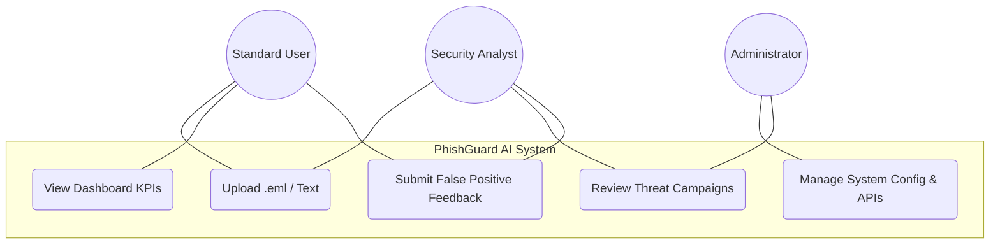
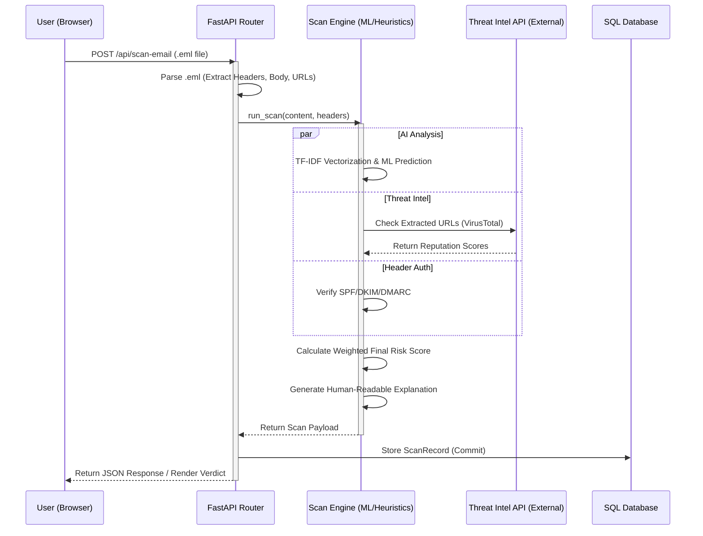

# Software Requirements Specification (SRS)
## PhishGuard AI: Intelligent Phishing Detection Ecosystem

**Author:** Muhammad Sharif Hassan  
**Supervisor:** Dr. Mareena Rashid  
**Department:** Computer Science & IT  
**University:** The Islamia University of Bahawalpur  
**Date:** April 22, 2026  

---

## 1. Introduction

### 1.1 Purpose
The purpose of this Software Requirements Specification (SRS) is to provide a comprehensive architectural and functional blueprint for **PhishGuard AI**. This document is intended for project supervisors, future developers, and security analysts. It outlines the scope, functional requirements, system models, and design constraints of the application, serving as the definitive baseline for both current evaluation and future production deployment.

### 1.2 Scope
PhishGuard AI is an advanced, asynchronous web-based security platform engineered to detect and mitigate phishing threats. Unlike rudimentary blocklist filters, PhishGuard utilizes a hybrid approach: combining Machine Learning (TF-IDF vectorization and probability models) with real-time external threat intelligence (VirusTotal API) and strict heuristic parsing. The system analyzes email content, embedded URLs, attachments, and cryptographic metadata (SPF/DKIM/DMARC) to generate a unified "Risk Score." It features a dynamic dashboard for threat monitoring, automated campaign clustering, and a user feedback loop to facilitate continuous AI learning.

### 1.3 Definitions, Acronyms, and Abbreviations
*   **ML (Machine Learning):** Statistical algorithms that allow the system to learn and improve prediction accuracy from data.
*   **SPF/DKIM/DMARC:** Standard email authentication protocols used to verify sender identity and prevent domain spoofing.
*   **TF-IDF:** Term Frequency-Inverse Document Frequency, a statistical measure used to evaluate how important a word is to a document in a corpus.
*   **JWT (JSON Web Token):** A secure, URL-safe means of representing claims to be transferred between two parties, used for authentication.
*   **API (Application Programming Interface):** Protocols allowing PhishGuard to communicate with external threat feeds like VirusTotal.
*   **Heuristics:** Rule-based analysis focusing on identifying known patterns of malicious behavior (e.g., urgency language).

### 1.4 References
1.  *IEEE Standard 830-1998*: Recommended Practice for Software Requirements Specifications.
2.  *FastAPI Documentation*: Asynchronous web framework guidelines.
3.  *SQLModel/SQLAlchemy Documentation*: ORM database architecture.

### 1.5 Overview
The remainder of this document details the system specifications. Section 2 provides a high-level product perspective and user characteristics. Section 3 enumerates the specific functional and non-functional requirements. Section 4 defines the external interfaces. Section 5 concludes with formal system modeling diagrams to visualize data flow and user interaction.

---

## 2. Overall Description

### 2.1 Product Perspective
PhishGuard AI operates as a standalone web application, designed to be deployed either as a public SaaS tool or an internal corporate security utility. It acts as an intermediary analysis layer, independent of specific email clients (like Outlook or Gmail), allowing users to manually verify `.eml` files, raw text, or isolated URLs.

### 2.2 Product Functions
*   **Multi-Vector Analysis:** Simultaneously parses email body text, extracts and scans URLs, and verifies header authentication.
*   **Hybrid AI Classification:** Generates a primary threat probability score using trained ML models, backed by heuristic fallback mechanisms.
*   **Real-Time Threat Intelligence:** Integrates with external APIs (e.g., VirusTotal) to verify extracted domains and IPs against global blocklists.
*   **Dynamic Threat Dashboard:** Visualizes scan history, risk trends, and real-time alerts through interactive charts.
*   **Campaign Intelligence:** Automatically correlates isolated scan records into grouped "Threat Campaigns" based on common attack vectors.
*   **Continuous Active Learning:** Allows users to flag false positives/negatives, establishing a feedback loop for future model retraining.

### 2.3 User Classes and Characteristics
*   **Standard User:** Requires a simplified, intuitive interface to quickly upload emails and receive a clear "Safe" or "Phishing" verdict without technical overload.
*   **Security Analyst:** Requires granular access to sub-scores (Content, URL, Header), threat intelligence raw data, and campaign grouping for incident response.
*   **System Administrator:** Responsible for managing user roles, configuring API keys, and monitoring overall system health.

### 2.4 Operating Environment
*   **Backend Server:** Python 3.10+ running FastAPI on a Linux (Ubuntu/Alpine) or Windows environment.
*   **Database:** Configured for SQLite in development, fully compatible with PostgreSQL for scalable production deployments via SQLModel.
*   **Frontend:** Cross-platform web interface compatible with all modern HTML5 browsers (Chrome, Safari, Firefox), optimized for both desktop and mobile viewports.

### 2.5 Design and Implementation Constraints
*   **Performance:** The core scanning engine must return a verdict in under 3 seconds to maintain a seamless UX.
*   **Security:** Passwords must be hashed using `bcrypt`. Sessions must utilize `HttpOnly` cookies. The application must sanitize all input to prevent XSS and SQL Injection.
*   **Aesthetics:** The UI strictly adheres to a premium, dark-mode-first "Precision Violet" design system, avoiding generic templates.

---

## 3. System Requirements

### 3.1 Functional Requirements

| ID | Feature | Description | Priority |
| :--- | :--- | :--- | :--- |
| **FR-01** | **User Authentication & OAuth** | The system shall support secure registration, JWT-based login, and OAuth 2.0 integration (Google/GitHub). | High |
| **FR-02** | **File Ingestion & Parsing** | The system shall accept and parse raw `.eml` files, extracting headers, body content, sender, and subject. | High |
| **FR-03** | **AI Content Scoring** | The system shall process text through a TF-IDF vectorizer and predict malice probability using a pre-trained ML model. | High |
| **FR-04** | **External Threat Intel (API)** | The system shall extract URLs and query external Threat Intelligence APIs (e.g., VirusTotal) for domain reputation. | High |
| **FR-05** | **Header Verification** | The system shall parse email headers to determine the pass/fail status of SPF, DKIM, and DMARC records. | Medium |
| **FR-06** | **Campaign Aggregation** | The system shall algorithmically group similar malicious scans into actionable "Campaigns" for analysts. | Medium |
| **FR-07** | **Feedback Loop** | The system shall provide a mechanism for users to verify or correct scan results, logging data for future ML retraining. | Low |
| **FR-08** | **Automated Reporting** | The system shall generate and distribute weekly security summary reports via background tasks. | Low |

### 3.2 Non-Functional Requirements
*   **Usability (Mobile-First):** The user interface must be fully responsive, featuring collapsible sidebars and fluid grids, ensuring flawless operation on Android, iPhone, and iPad.
*   **Security (Data at Rest):** All sensitive user data and historical scan logs must be securely stored; database connections must support TLS.
*   **Maintainability:** The backend must follow a modular architecture (separation of routers, services, and data layers) to allow rapid feature expansion.
*   **Availability:** The web server shall be designed for high availability, utilizing asynchronous request handling to prevent blocking during heavy ML computations.

---

## 4. External Interface Requirements

### 4.1 User Interfaces
The frontend utilizes a premium Glassmorphism aesthetic. Key interfaces include:
*   **Dashboard (`dashboard.html`):** Features Chart.js visualizations for 7-day risk trends and statistical counters.
*   **Analyzer (`analyze.html`):** Offers dual-input methods (drag-and-drop `.eml` upload vs. raw text paste) with real-time processing indicators.
*   **Settings (`settings.html`):** A professional management console allowing users to toggle UI themes, manage connected OAuth accounts, and securely delete their data.

### 4.2 Software Interfaces
*   **FastAPI / Uvicorn:** The primary ASGI web server bridging the client and Python logic.
*   **External APIs:** RESTful communication with third-party security feeds (VirusTotal, PhishTank) via HTTPS.
*   **SQLAlchemy / SQLModel:** The ORM layer abstracting raw SQL queries into object-oriented Python syntax.

---

## 5. System Modeling

### 5.1 Use Case Diagram
The following diagram illustrates the primary interactions between user roles and the PhishGuard ecosystem.

### 5.2 System Architecture Sequence
The sequence diagram details the data flow during a core email scan operation.

---
*End of Document. Prepared for final academic review.*
